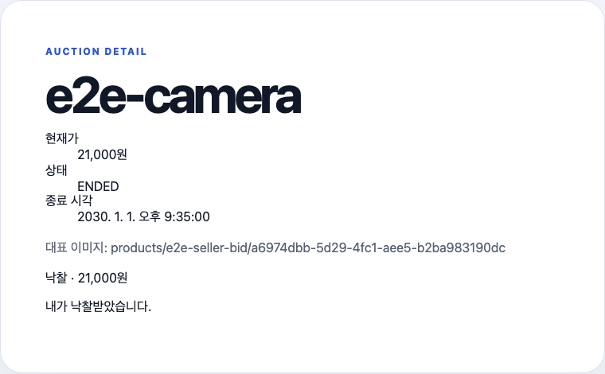
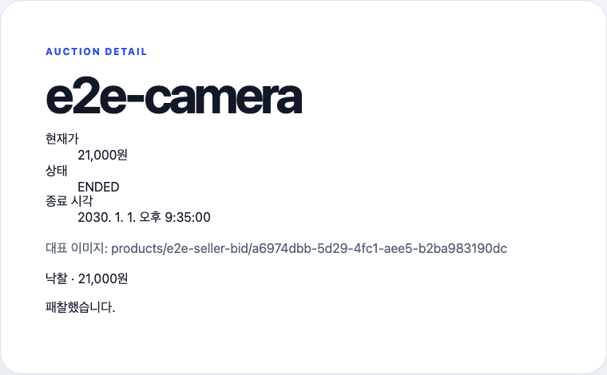

# BidFlow

> 경매 마감 직전의 동시 입찰을 순서 있게 처리하고, 장애 뒤에도 원장으로 복구하는 중고 경매 플랫폼

BidFlow는 단순한 CRUD 경매 서비스가 아니라 **동시 입찰의 정합성**을 다루는 포트폴리오 프로젝트다. 같은 경매의 입찰 명령은 Kafka에서 순서 있게 소비하고, 활성 경매의 가격 계산은 Redis Lua Script로 원자적으로 수행한다. PostgreSQL은 입찰 원장과 Outbox를 보관하는 최종 사실의 원천이며, Consumer는 멱등 처리로 at-least-once 전달의 중복 효과를 제거한다.

**스택:** React · TypeScript · Vite / Java 21 · Spring Boot / PostgreSQL · Kafka · Redis · OpenSearch · SeaweedFS(S3 호환). AWS 검증 환경은 Terraform으로 정의한다.

## 현재 구현 범위

| 영역 | 현재 상태 | 설명 |
|---|---|---|
| 상품 등록 | 구현됨 | SeaweedFS(S3 호환) presigned upload와 상품·경매 생성 API |
| 상품 검색 | 구현됨 | OpenSearch 검색·필터와 검색 결과 → 경매 상세 이동 |
| 입찰 엔진 | 구현됨 | Redis Lua 직접/자동 입찰, 요청 재실행, Redis 복구 |
| 자동 연장·종료 | 구현됨 | 마감까지 5분 미만일 때 입찰 승인 시 기존 종료 시각 +5분. 낙찰·유찰 확정, 본인 결과 조회 |
| Kafka·Outbox | 구현됨 | 경매별 Key, Consumer 멱등성, DLT 계약 |
| Browser E2E | 로컬 검증 | 검색 포함 기능 5개와 새 경매의 원장·이벤트 교차 검사 통과 |
| k6·장애 실험 | 로컬 실측 | 단일 경매 20 VU 누적 1,000건, 분산 입찰과 정산 Consumer·Redis·OpenSearch 중단 후 복구 |
| AWS 배포 | 설계·정적 검증 | Terraform과 검증 Runbook 준비. 실제 배포·청구·Destroy 검증은 미실행 |

## 핵심 시연과 결과

마감 1분 전 두 사용자의 자동 입찰이 경쟁하면 기존 마감이 5분 연장된다. 새 마감에 두 화면은 공개 낙찰가 21,000원으로 일치하지만 로그인한 각 사용자는 자신의 낙찰·패찰만 확인한다. [로컬 Browser 시연 재현](docs/reports/issue-099-playwright-e2e.md)

같은 테스트 경매를 두 브라우저 세션에서 캡처했다. 공개 가격은 같고, 본인 결과만 다르다.

| 입찰자 A — 낙찰 | 입찰자 B — 패찰 |
|---|---|
|  |  |

- **분산 입찰:** 경매 6개, 20 VU 유지 구간 2분. 2,535건 모두 접수됐고, 접수 P95는 **41.88ms**, 서버 요청 기록부터 처리 시작까지 P95는 **1,338.53ms**였다. 미처리와 중복 원장은 0건이었다. 최종 DB 커밋이나 브라우저 결과 전달 지연은 측정하지 않았다. [부하 실측](docs/reports/issue-019-distributed-load-baseline.md)
- **단일 경매 누적 1,000건:** 20 VU × 50회, 요청·원장·결과 각각 1,000개. 승인 207건·정상 거절 793건·미처리 0건, 접수 P95 **290.48ms**·P99 **713.15ms**, HTTP 오류율 0%였다. 공유 로컬 환경 한 번의 결과이며 P95 기준 여유는 약 9.52ms뿐이다. [실행·복원 증적](docs/reports/issue-019-instrumented-rerun.md)
- **기능 E2E:** 등록/유찰·자동입찰/낙찰·직접입찰 재시도·재연결·검색의 5개가 실패/skip/retry 없이 통과했다. 새 경매 8개의 원장·이벤트도 사후 SQL로 대조했다. 로컬 테스트 인증/Clock 조건이며 Cognito/AWS 검증은 아니다. [회귀 결과](docs/reports/issue-020-local-functional-regression.md)
- **장애 복구:** 정산 Consumer만 멈춰도 입찰 접수는 유지됐고, 재시작 후 대기 3건이 중복 없이 정산됐다. 반면 검색 그룹 Lag가 0이어도 DLT로 이동한 이벤트의 문서는 검색에서 빠졌다. [장애 사례와 회고](docs/reports/issue-102-portfolio-retrospective.md)

## 핵심 흐름

```text
판매자: 이미지 직접 업로드 → 상품/경매 등록 → Outbox → Kafka → 검색 Projection

구매자: 입찰 접수(202) → PostgreSQL 요청/Outbox → Kafka(auctionId Key)
        → Bid Worker → Redis Lua 가격 계산 → 원장/결과 Outbox
        → Kafka → 검색·실시간 Projection
```

입찰 API는 최종 낙찰 결과가 아니라 **접수 결과**를 반환한다. 최종 처리 결과는 이벤트와 상태 조회로 확인하는 비동기 계약이다.

## 왜 이 기술을 사용했나

| 기술 | 담당 문제 | 선택 근거 |
|---|---|---|
| PostgreSQL | 입찰 원장과 낙찰의 최종 사실 | Transaction, 제약조건, 잠금, Outbox를 하나의 내구성 경계로 유지 |
| Kafka | 경매별 순서·독립 Consumer·이벤트 재생 | `auctionId` Key의 Partition 순서와 Consumer Group별 Offset을 사용 |
| Redis Lua | 활성 경매의 원자적 가격 계산 | 여러 Key 변경 중간 상태를 노출하지 않고 요청 재시도 결과를 고정 |
| OpenSearch | 전문 검색과 Filter/정렬 | PostgreSQL 원본에서 재생 가능한 읽기 Projection으로 분리 |
| SeaweedFS/S3 | 상품 이미지 전송 | Browser가 presigned URL로 직접 업로드하여 API 서버 부하를 분리 |

Kafka는 전역 순서나 exactly-once를 보장한다고 주장하지 않는다. 같은 Partition의 순서와 at-least-once 전달을 전제로, `bidRequestId`·`eventId`·`consumer_event`로 결과를 멱등하게 만든다.

## 로컬 실행

### 필요 환경

- Docker Desktop
- Java 21
- Node.js 24

로컬 구성은 PostgreSQL, Kafka, Redis, SeaweedFS를 Docker로 실행한다. OpenSearch는 메모리 사용량 때문에 별도 profile로 분리했다.

```bash
# 기본 인프라: PostgreSQL, Kafka, Redis, SeaweedFS 및 Kafka Topic
make local-up

# OpenSearch까지 포함
make local-up-search
```

새 터미널에서 백엔드와 프론트엔드를 실행한다.

```bash
# Spring Boot API (로컬 X-Actor-Id adapter 활성화)
SPRING_PROFILES_ACTIVE=local ./backend/gradlew -p backend :runtime:bootRun

# Vite 개발 서버
cd apps/web
npm ci
npm run dev
```

`local`(또는 `local,e2e`)에서는 Outbox 조회 간격이 100ms다. `local`이 없으면 공통 fallback은 1,000ms로 유지된다. [로컬 대조 실험](docs/reports/issue-019-outbox-delay-aba.md)에서 화면 관측 지연이 줄었지만 유휴 조회와 DB CPU 사용은 늘었다. DEBUG 로그는 기본으로 켜지지 않으며, 이 설정을 위해 AWS에서 로컬 인증 프로필을 사용하지 않는다.

로컬에서도 이전 1,000ms 간격을 쓰려면 기존 API를 종료한 뒤 명시적으로 지정한다. 설정 파일 변경만으로 실행 중 프로세스가 바뀌지는 않는다.

```bash
SPRING_PROFILES_ACTIVE=local ./backend/gradlew -p backend :runtime:bootRun \
  --args='--bidflow.outbox.fixed-delay-ms=1000'
```

로컬 서비스를 멈출 때는 다음 명령을 사용한다. `local-reset`은 데이터 볼륨을 초기화하므로 테스트 데이터가 필요 없을 때만 실행한다.

```bash
make local-down
```

환경변수 기본값은 [.env.example](.env.example)에 있으며, 이 값은 로컬 Docker 전용이다. AWS Secret이나 운영 자격 증명으로 재사용하지 않는다.

## 테스트와 검증

Java 21을 `JAVA_HOME`, Node 24를 `PATH`에 선택한 뒤 실행한다. 기본 검증에는 Docker·로컬 API·AWS 자격증명이 필요 없지만 Maven/npm 의존성 다운로드는 필요할 수 있다.

```bash
# 최초 의존성 준비와 지원 명령 확인
make setup
make help

# 정적 검사 → 백엔드 단위 → Vitest → 스크립트 테스트 → 양쪽 빌드
make verify

# 개별 검증 또는 빌드
make test-backend
make test-web
make test-scripts
make build

# Docker와 기본 로컬 서비스가 실행 중일 때만: skip/실행 누락을 차단하는 전체 backend check
make verify-integration

# k6 입찰 부하: 로컬 API와 활성 경매·입찰자 Fixture 필요
make load-focused
make load-distributed
```

`unitTest`는 명시적인 `integration` 태그만 제외한다. 기존 `test`/`check`는 통합 테스트를 포함하며, 결과는 각각 `backend/<module>/build/reports/tests/unitTest/`와 `backend/<module>/build/reports/tests/test/`에 분리된다. `verify-integration`은 `check -Pbidflow.strictIntegration=true --rerun-tasks`로 다섯 모듈의 실제 실행을 요구하고 skip·빈 집합·결과 누락·축소 필터를 실패로 처리한다. 서비스 자동 시작/초기화는 하지 않는다. 엄격 속성이 없는 일반 `check`의 기존 동작은 유지되므로 두 명령의 성공 의미를 구분한다. [엄격 검증 사양](docs/specs/issue-020-integration-completeness.md)

[전체 백엔드 재검증](docs/reports/issue-020-backend-full-check.md)에서는 192개(통합 태그 46개 포함)가 실패/skip 없이 통과했다. 첫 실행은 Docker 소켓 mount 문제로 45개가 skip됐으므로 Gradle 성공만으로 통합 성공을 판단하지 않았다. 이 Mac의 Docker Desktop에서는 호출 시 `TESTCONTAINERS_DOCKER_SOCKET_OVERRIDE=/var/run/docker.sock`을 별도로 지정했으며 전역 설정은 바꾸지 않았다. 재현 명령과 적용 범위는 보고서에 있다.

PR과 main push의 GitHub Actions도 `make verify`를 사용한다. CI는 Java 21·Node 24와 읽기 전용 권한을 사용하며 배포하지 않는다. CI의 whitespace 검사는 기준 SHA부터 변경분을 검사하고, 로컬 기본 실행은 작업 트리와 staged diff를 검사한다. [공통 검증 사양](docs/specs/issue-003-verification-ci.md) · [구현과 검증 결과](docs/reports/issue-003-verification-ci.md)

k6 입력과 실행 방법은 [k6 부하 시나리오](docs/reports/issue-095-k6-bid-load.md), 기존 JSON·SQL·Lag 증적은 [결과·회고](docs/reports/issue-102-portfolio-retrospective.md)에서 확인할 수 있다. Playwright는 [별도 로컬 실행 절차](docs/reports/issue-099-playwright-e2e.md)에 따라 테스트 전용 Clock을 사용한다.

## 문서 지도

- [Architecture](docs/architecture.md): S/D/B/I/T 책임 경계와 요청·복구 흐름
- [ADR 인덱스](docs/adr/README.md): 기술 선택, 대안, 전환 조건
- [제품 범위](docs/specs/issue-001-project-scope.md): 사용자·MVP·성공 기준
- [검증 결과·회고](docs/reports/issue-102-portfolio-retrospective.md): 브라우저 시연, 부하·장애 실측, 한계
- [Kafka/SQS 선택과 비용](docs/reports/issue-097-kafka-performance-cost.md): 기술 대안과 공개 요금 추정
- [AWS 검증 Runbook](docs/specs/issue-017-aws-deployment.md): 승인·단기 배포·삭제 확인 절차

## 로드맵과 한계

로컬 20 VU 기준선·누적 1,000건 HTTP·1,000건 어댑터 정합성 테스트는 각각 다른 검증이다. 어느 것도 1,000건 전체 동시 HTTP 부하나 운영 처리량을 보장하지 않는다. 누적 1,000건의 [첫 시도는 585건에서 중단](docs/reports/issue-019-focused-load-collector.md)됐고, 명령 추적을 연결한 별도 새 실행이 통과했다. 첫 중단의 정확한 원인은 미확정이며 재검증 성공을 원인 해결이나 통제된 성능 개선으로 해석하지 않는다.

[별도 20건 실험](docs/reports/issue-019-final-settlement-observation.md)에서 최종 DB 가시성을 관측했다. 초기 [브라우저 순차 20건](docs/reports/issue-019-browser-result-latency.md)의 화면 관측 P95는 2,938ms로 2초 기준에 미달했다. 이후 [Outbox 간격 대조](docs/reports/issue-019-outbox-delay-aba.md)에서는 1,000ms 조건의 약 2.93초가 100ms 조건에서 431ms로 줄었지만 유휴 조회 빈도와 DB CPU는 늘었다. [로컬 프로필 100ms 적용 확인](docs/reports/issue-019-local-outbox-delay.md)에서는 P95 430ms를 확인했다. 서로 다른 실험을 동시 부하 SLO로 합치지 않으며 자동화 polling 비용도 포함한다.

[두 사용자 동시 제출 10회](docs/reports/issue-019-concurrent-snapshot-fix.md)에서는 요청 20건과 SQL 대조가 모두 완료됐고 화면 수렴 관측 P95는 443ms였다. 개인 메시지의 최신 snapshot과 요청별 정산을 혼동한 초기 관측 실패를 재현·수정했다. 두 건씩 겹친 제한된 실험이며, 20건 전체 동시 부하나 AWS SLO로 일반화하지 않는다.

초기 E2E 시간 초과 2건은 [세 번의 재시작 관측](docs/reports/issue-019-startup-observation.md)에서 재현되지 않았고 원인은 미확정이다. 공통 검증은 `make verify`로 실행하며, 통합·브라우저·부하·AWS 검증은 별도 범위로 유지한다.

AWS는 상시 운영하지 않는다. 별도 승인 뒤 짧게 생성하고 배포·기능·비용을 확인한 뒤 삭제하는 계획이다. 실제 AWS 계정에서 실행한 결과는 아직 없다.

상세 설계와 증적 상태는 [포트폴리오 문서 구성과 증적 목록](docs/specs/issue-021-portfolio-docs.md)을 기준으로 한다.
